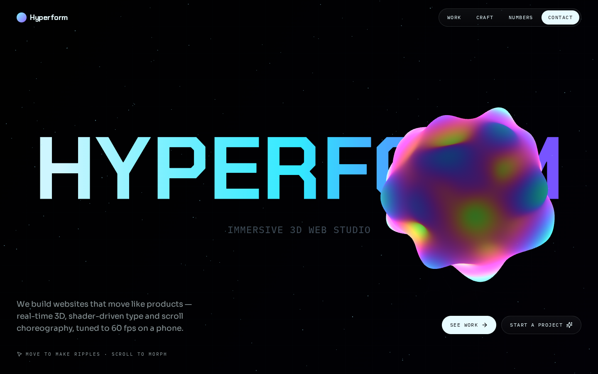

# 3D Web Builder Toolkit

Reusable brain + starter for building immersive 3D / animated websites, phase by phase, ending on GitHub + Vercel.
Free tools only (no paid MCPs used).

## Inventory

| Path | What it is |
|---|---|
| [`PLAYBOOK.md`](PLAYBOOK.md) | **The builder brain**: canonical stack, techniques catalog (zip sites first, then repos, each with source), perf/a11y rules, error pitfalls, mandatory 9-phase process with entry/exit checklists |
| [`SKILL-DRAFT.md`](SKILL-DRAFT.md) | Concise agent skill `3d-web-build-process` (phases + stack) to install as a skill |
| [`starter/`](starter/) | Working Vite starter: Three.js ripple-refracted shader hero + noise blob, GSAP ScrollTrigger choreography, Lenis, Tailwind v4, Lucide, vercel.json, ESLint, Playwright QA script |
| [`zip-sites/`](zip-sites/) | The user's "perfect 3D sites": source + `ANALYSIS.md` per site + `screenshots/` (zip 1 done; zips 2–4 need re-upload) |
| [`skills-library/`](skills-library/) | 52 vendored skills (GSAP ×8, three.js ×13, Anthropic ×7, Emil Kowalski ×13, web-quality ×6, impeccable, taste, ui-ux-pro-max, true-web-clone) — see `INDEX.md` |
| [`SKILLS-AND-MCPS.md`](SKILLS-AND-MCPS.md) | Ranked skills with URLs, free MCP servers worth connecting, free APIs/asset sources (paid ones flagged) |
| [`references-notes/`](references-notes/) | URL list + licence + technique notes for all 16 reference repos and 2 live sites, GitHub topic top-lists, `clone-all.sh` |
| [`references-screenshots/`](references-screenshots/) | Headless screenshots of the static reference sites + live sites |
| [`tools/`](tools/) | `shoot.mjs` (screenshot any URL at scroll fractions + report console errors), `otis-interact.mjs` (interaction capture example) |
| [`docs/screenshots/`](docs/screenshots/) | Starter QA screenshots (desktop, pinned gallery, marquee, mobile, reduced-motion) |

## Running the next project (phase by phase)
1. **Brief + audit** — create `PROJECT.md` from PLAYBOOK §4; study `zip-sites/*/ANALYSIS.md` + `references-notes/REFERENCES.md` for matching techniques.
2. **Setup** — load the skills listed for the brief (`skills-library/INDEX.md`), confirm GitHub/Vercel, optional free MCPs from `SKILLS-AND-MCPS.md`.
3. **Design system** — write tokens into `src/style.css @theme`.
4. **Scaffold** — `cp -r starter ../my-site && cd ../my-site && npm i && npm run build && npm run lint`.
5. **3D scene** — edit `src/scene/stage.js` + shaders (or swap in R3F for model-heavy briefs).
6. **Motion** — edit `src/motion/choreography.js` (master timeline maps scroll → scene state).
7. **Content + responsive** — sections in `index.html` (or components), check 390→1920.
8. **QA** — `npm run lint && npm run build && npm run qa` → zero console errors, review `qa-screenshots/`.
9. **Ship** (with approval) — `gh repo create … --push`, deploy on Vercel, `npm run qa -- --url <prod>`.

## Re-creating references
`bash references-notes/clone-all.sh` (shallow clones, ~1 GB; not vendored because of size and licences).

## Licences
Starter code: MIT (this repo). Vendored skills keep their own LICENSE files (MIT / Apache-2.0).
Zip-site sources belong to the user. Reference repos are linked, not copied; "no licence" repos are study-only.
